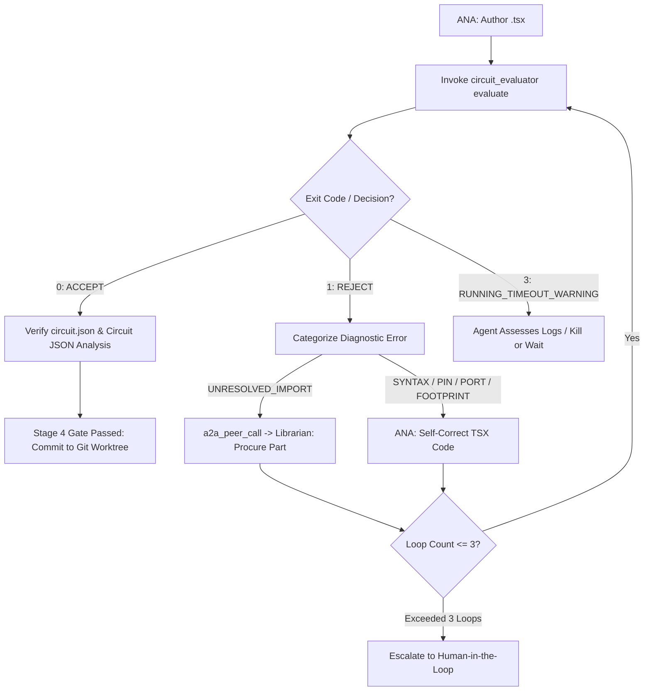

# VAP-Equivalent Circuit Validation Architecture (MESH & ECP)

## 1. Executive Summary & Context

The original **VHL ANA Process (VAP)** was a dedicated circuit evaluation and validation engine implemented within the runtime layer (`src/vap/`). It was devised during an earlier phase of the Virtual Hardware Laboratory when the control plane (`vhl-agent-backend`) and deterministic execution plane (`vhl-runtime`) ran as isolated services across WebSocket boundaries.

Under that legacy model, circuit evaluation required splitting validation into fine-grained client-server polling cycles (`VAP_init`, `VAP_status`, `VAP_EXECUTE`, `VAP_DECISION`). 

With the unification of `vhl-backend` and the deployment of the **MESH multi-agent framework**, this fine-grained, hardcoded runtime protocol has been deprecated and removed. MESH enables autonomous agent clusters (Archy, ANA, Librarian) to execute, inspect, diagnose, and self-heal circuit evaluations locally in their worktrees via **declarative workflow markdown documents** and **Engineering Capability Packages (ECPs)**.

---

## 2. Legacy VAP vs. MESH ECP Architecture

| Dimension | Legacy VAP (`src/vap/`) | Modern MESH Architecture |
| :--- | :--- | :--- |
| **Location of Logic** | Hardcoded TypeScript daemon in `vhl-runtime` (`src/vap/evaluator.ts`) | Standalone ECP tools (`vhl-circuit-evaluator`) invoked directly by agents |
| **Execution Protocol** | Multi-step WebSocket relay messages (`VAP_init` $\rightarrow$ poll $\rightarrow$ `VAP_DECISION`) | Direct CLI/tool invocation in local Git worktree (`tools/circuit_evaluator`) |
| **State Machine** | Global runtime state ledger (`Default` $\rightarrow$ `EvalInProgress` $\rightarrow$ `EvalComplete`) | Local workflow stage gates defined in markdown (`module-synthesis-workflow`) |
| **Timeout Handling** | Hardcoded process-kill timeout boundary | Configurable, non-terminating timeout warning; agent retains decision authority |
| **Error Diagnostics** | Raw log dumps and rudimentary ANSI error counts | Structured diagnostic taxonomy (`UNRESOLVED_IMPORT`, `FOOTPRINT_ERROR`, `UNROUTED_PORT`, etc.) |
| **Self-Healing Loop** | Remote round-trip re-triggering across WebSocket relay | Bounded (max 3 iterations) peer delegation (`ANA` $\leftrightarrow$ `Librarian`) within worktree |

---

## 3. Core Capability Assets (ECPs)

Circuit validation is now decomposed into modular, reusable skills adhering to the Engineering Capability Package (ECP) specification:

### 3.1 `vhl-circuit-evaluator`
- **Location**: `.agents/skills/vhl-circuit-evaluator/`
- **Purpose**: Autonomous, deterministic evaluation of `<module_name>.tsx` and `<assembly_name>.tsx` files using `tsci build`.
- **Tool Asset**: `tools/circuit_evaluator`
- **Responsibilities**:
  - Spawns `tsci build` against the target circuit TSX inside the module worktree.
  - Strips ANSI escape codes and terminal color blocks.
  - Parses logs against a comprehensive regex taxonomy to categorize failures.
  - Enforces non-terminating timeout warnings to give the calling agent full control over process lifecycle.
  - Emits JSON or human-readable execution summaries with clear `ACCEPT` / `REJECT` verdicts.

### 3.2 `module-synthesis-workflow`
- **Location**: `.agents/skills/module-synthesis-workflow/`
- **Purpose**: Governs the 4 sequential Stage Gates for autonomous hardware synthesis:
  - **Stage 1**: SCUD Authoring (Schematic Circuit Understanding Document)
  - **Stage 2**: Component Procurement (Librarian resolution and verification)
  - **Stage 3**: Circuit TSX Synthesis (ANA Breadth-First Search with Degree Centrality)
  - **Stage 4**: Deterministic Verification & Error Rectification (Self-healing evaluation loop)

### 3.3 `circuit-json-analysis`
- **Location**: `.agents/skills/circuit-json-analysis/`
- **Purpose**: Post-compilation structural and geometric DRC validation:
  - Validates `circuit.json` component hierarchy.
  - Checks domain mappings (`source_component`, `schematic_component`, `pcb_component`).
  - Detects physical layout overlaps (courtyard violations, clearance faults, pad alignments).

### 3.4 `module-cluster-orchestrator`
- **Location**: `.agents/skills/module-cluster-orchestrator/`
- **Purpose**: High-level governance by Archy:
  - Manages peer dialing via `a2a_peer_call`.
  - Hard-caps self-healing loops at **3 iterations** between ANA and Librarian.
  - Escalates persistent failures to Human-in-the-Loop (HIL).

---

## 4. Verification Workflow Execution Model



### 4.1 Invocation Protocol
ANA invokes the circuit evaluator from the workspace worktree:
```bash
tools/circuit_evaluator evaluate \
  <module_name>.tsx \
  --worktree ./Workspace \
  --timeout 60 \
  --json
```

### 4.2 Error Taxonomy & Automated Remediation

| Diagnostic Category | Example Trigger Pattern | Remediation Action |
| :--- | :--- | :--- |
| `UNRESOLVED_IMPORT` | `Cannot find module './components/...'` | Dial Librarian to resolve and scaffold component. |
| `FOOTPRINT_ERROR` | `No footprint specified for component` | Inject standard footprint or update component definition. |
| `UNROUTED_PORT` | `Port pinX on undefined is missing a trace` | Wire unconnected port to proper netlabel or boundary. |
| `COMPONENT_PIN_MISMATCH` | `Property 'pinX' does not exist` | Re-align pin numbering with component `pinLabels`. |
| `SYNTAX_ERROR` | Unclosed JSX element, bracket mismatch | Fix syntax error in TSX source. |
| `TYPE_ERROR` | TypeScript compiler error (`TS2322`) | Rectify prop types or interface signatures. |
| `BUILD_FAILURE` | Generic compiler failure | Inspect raw log tail for compiler trace. |

---

## 5. Specification Placeholders for Future Extensions

The following subsections serve as design placeholders for ongoing multi-agent and synthesis refinement:

### 5.1 [Placeholder] Standardized Evaluation Report Schema
*To capture JSON schema definitions for evaluator outputs across module clusters and assembly worktrees.*

### 5.2 [Placeholder] Multi-Module Assembly DRC & Net Reconciliation
*To specify multi-module interconnect verification protocols for Master Archy and Assembly ANA in the project root worktree.*

### 5.3 [Placeholder] Headless UI Snapshot Integration
*To define visual snapshot verification rules using the UI Snapshot MCP server (`dist/mcp/ui_snapshot`) for schematic and PCB layout inspection.*

### 5.4 [Placeholder] Regression Test Invariants
*To document synthetic test scenarios validating ECP evaluation execution across diverse project topologies without runtime backend coupling.*
